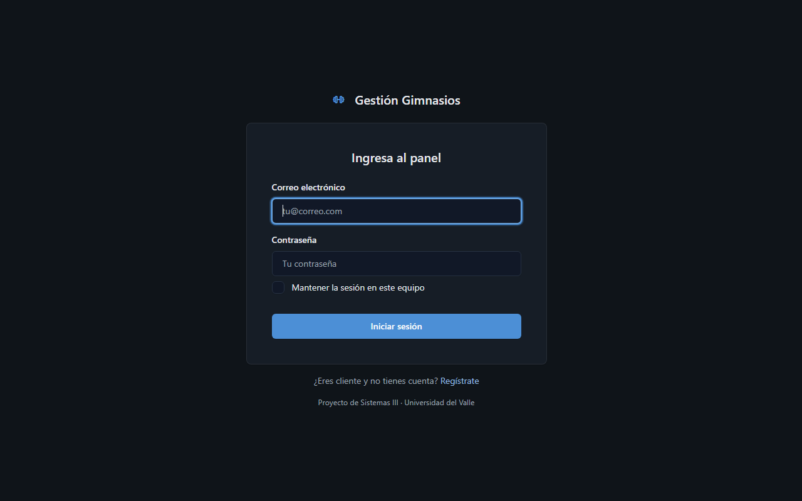
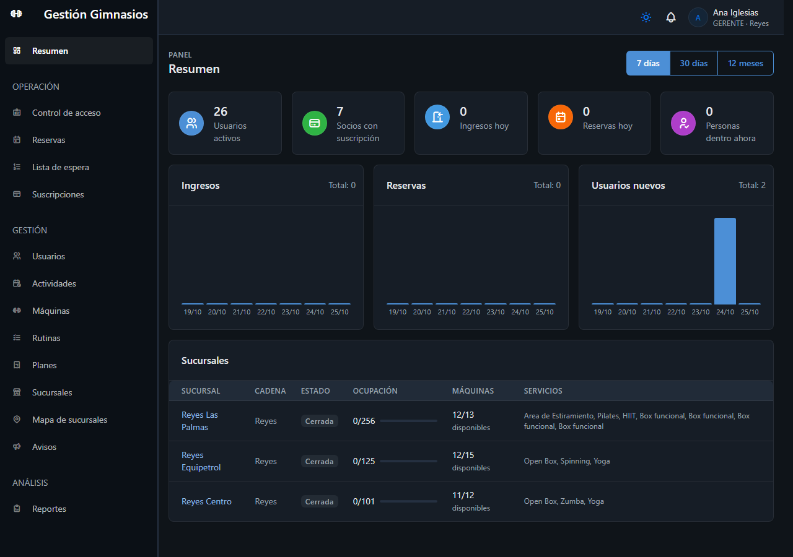
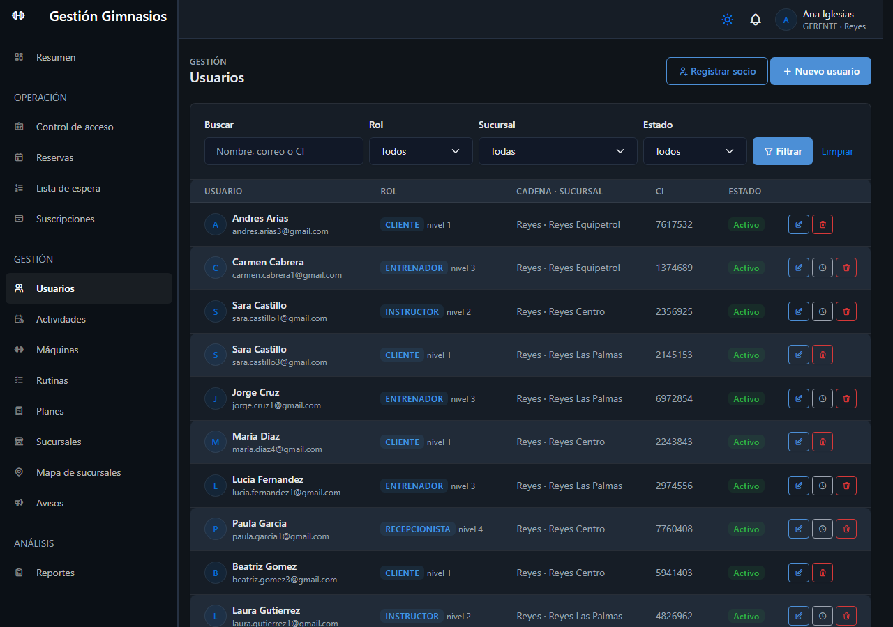
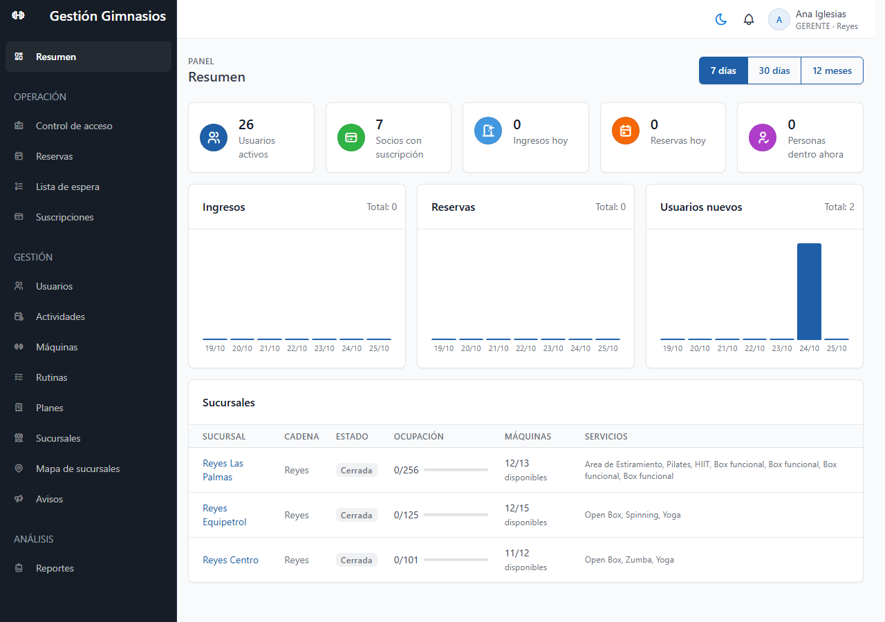

# Propuesta visual oscura del panel (HU-52 · actividad B, EDT 2.1)

El docente pidió un panel **más oscuro, consistente y con una identidad reconocible**. Antes de
aplicar el estilo a todas las vistas (actividad D), se validan pantallas representativas y se
elige la plantilla.

## 1. Pantallas para validar

| Inicio de sesión | Resumen (gerente) |
|---|---|
|  |  |

| Usuarios (listado con filtros) | Resumen en tema claro (comparación) |
|---|---|
|  |  |

## 2. Cómo está hecho

- **Plantilla:** Tabler 1.5, que ya usa el panel, en su **modo oscuro nativo** (`data-bs-theme="dark"`
  en `<html>`). Todos los componentes (tablas, formularios, tarjetas, menús) cambian juntos, sin
  reescribir vistas.
- **Identidad:** en `wwwroot/css/site.css` se definen:
  - el azul de la marca: `#1F5FA8` en el tema claro y `#4C8FD6` en el oscuro, para mantener el
    contraste;
  - el fondo, las superficies y los bordes propios;
  - el menú lateral más oscuro que el contenido.
- **Selector de tema:** el botón sol/luna de la barra superior cambia entre oscuro y claro, y
  guarda la preferencia en el navegador. El tema oscuro es el predeterminado.
- **Sin cambios funcionales:** solo se tocaron los layouts, el CSS y un script de 9 líneas. Las
  rutas, los formularios y la API siguen iguales.

## 3. Comparación de plantillas (todas están en la guía del curso)

| Criterio | Tabler personalizado | AdminLTE | CoreUI |
|---|---|---|---|
| Modo oscuro | Nativo, por atributo, sin duplicar CSS | Disponible en la versión 4 (Bootstrap 5) | Nativo en la versión 5 |
| Costo de adoptarla | Ninguno: ya es la base de las 33 pantallas del panel | Reescribir el layout y adaptar clases en todas las vistas | Reescribir el layout y los componentes |
| Riesgo de regresiones | Bajo: mismos componentes | Medio | Medio |
| Aspecto | Sobrio, tipografía legible, tablas compactas | Clásico de administración, más denso | Empresarial, con componentes propios |
| Licencia | MIT | MIT | MIT (versión libre) |

**Propuesta del equipo:** mantener **Tabler en tema oscuro**. Cumple lo pedido sin rehacer el panel,
y deja el tiempo de la iteración para las mejoras RF. La decisión final es del docente, en la
revisión de la Iteración 1. Si elige otra plantilla, la actividad D (#53) se reestima.

## 4. Reglas visuales para las demás vistas (actividad D)

Siguen las "señales de una interfaz hecha con IA" que la guía del curso pide evitar:
- sin degradados ni brillos;
- íconos de Tabler en lugar de emojis;
- textos sobrios, sin frases grandilocuentes;
- el mismo patrón en cada pantalla: título, acciones a la derecha, filtros en una tarjeta y tabla;
- esquinas y sombras moderadas.
